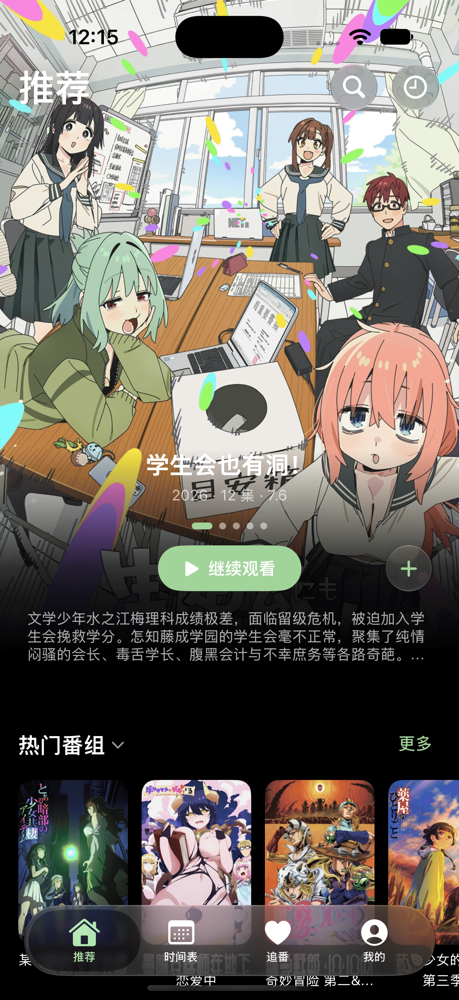
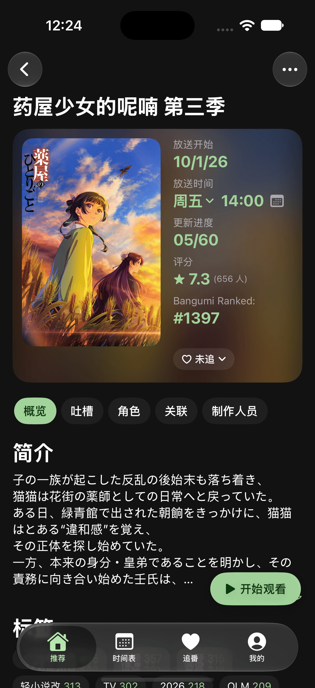
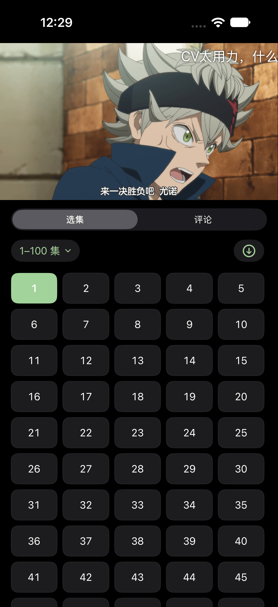
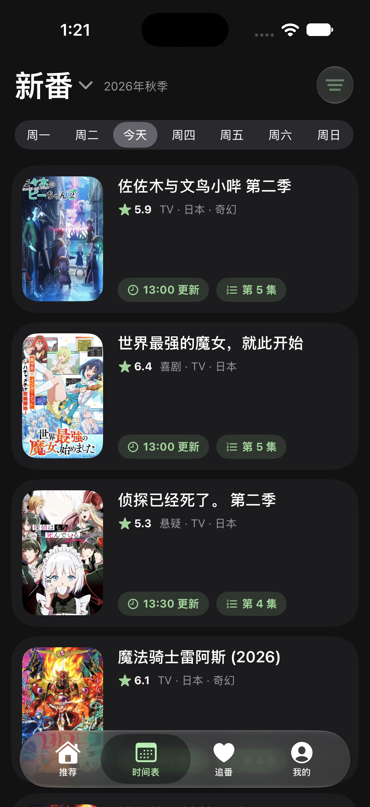
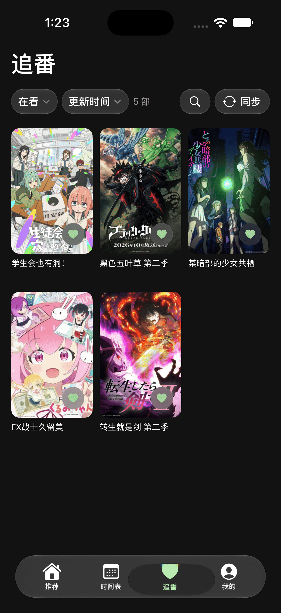
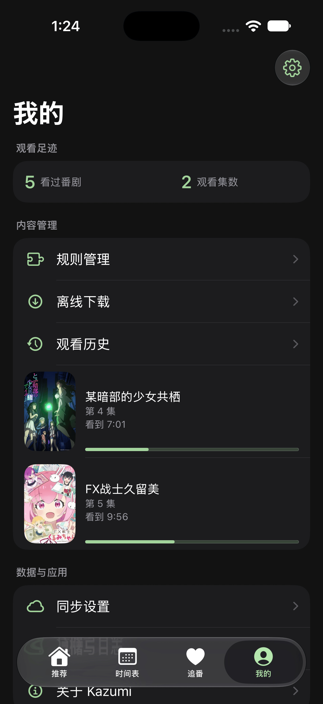

<div align="center">


# Kazumi for iOS

基于自定义规则的番剧采集与在线观看客户端，带弹幕。<br>
原生 SwiftUI 实现，界面使用 iOS 26 的液态玻璃材质，随系统外观与辅助功能设置变化。


</div>

## 屏幕截图

<table>
<tr>
<td align="center"></td>
<td align="center"></td>
<td align="center"></td>
</tr>
<tr>
<td align="center">推荐</td>
<td align="center">番剧详情</td>
<td align="center">播放</td>
</tr>
<tr>
<td align="center"></td>
<td align="center"></td>
<td align="center"></td>
</tr>
<tr>
<td align="center">时间表</td>
<td align="center">追番</td>
<td align="center">我的</td>
</tr>
</table>

## 特点

- **规则采集** —— 每个站点由一条自定义规则定义，可导入、分享，或从规则仓库直接安装；站点改版时修改规则即可，无需等待应用更新。
- **在线播放** —— 内置 mpv 播放内核，0.5 至 3 倍速共九档，自动记录播放进度，支持后台与锁屏播放。
- **超分辨率** —— 内置 Anime4K v4.0.1 着色器，提供关闭、效率、质量三档，播放过程中实时处理，无需预先转码。
- **弹幕** —— 接入弹弹play 弹幕并按时间轴叠加显示；位置、字号、速度、描边、颜色与去重均可调节，支持关键词屏蔽。
- **片头片尾** —— 时间轴来自 AniSkip，进入片头或片尾前 5 秒弹出倒计时，不操作会自动跳过，点「取消」这一段就不跳。
- **追番** —— 支持绑定 Bangumi 账号，追番状态与观看进度集中显示；播放进度达到 90% 时可自动标记该集为看过（默认关闭）。
- **更新通知** —— 追番中的番剧有新集时发送本地通知；排定时刻按首播时间与播出周期推算，设置里可查看已排定的提醒。
- **时间表** —— 按放送星期排列，也可改为按更新时间排序；每部显示当天的更新时间（HH:mm）与已播出到第几集；规则未提供放送日的番剧可手动指定星期，纳入时间表。
- **下载** —— 支持整部或单集下载至本机，离线可播放；占用空间与删除操作均在下载页管理。
- **搜索** —— 支持关键词搜索，也可上传截图以图搜番（trace.moe）。
- **一起看** —— 在播放器菜单中创建房间，多人同步观看（SyncPlay）。
- **快捷指令** —— 支持快捷指令与 Siri：打开番剧、搜索番剧、打开观看历史或下载、查看今日更新与观看进度、查看本机收藏，可直接接进自动化。
- **深链** —— 支持 kazumi:// 深链，可从番剧、搜索、下载等六种入口直达对应页面。
- **备份** —— 设置可导出为文本或文件，换机时从剪贴板或文件恢复；追番与观看历史可通过 WebDAV 备份。

界面跟随系统语言，提供简体中文与繁体中文。

## 安装

发布的是**未签名 ipa**，要自己签名后装进手机，系统要求 iOS 26 及以上。

1. 从 [Releases](https://github.com/LinkPass888/Kazumi-iOS/releases/latest) 下载最新 ipa
2. 用 [AltStore](https://altstore.io/)、[Sideloadly](https://sideloadly.io/) 这类工具装进去，自备 Apple ID 签名

## 从源码构建

```bash
brew install xcodegen
xcodegen generate --spec ios/project.yml --project ios
xcodebuild -project ios/Runner.xcodeproj -scheme Runner \
  -destination 'generic/platform=iOS' build
```

需要 Xcode 27 的工具链（iOS 27 SDK）。

## 常见问题

<details><summary>为什么番剧里会出现广告？</summary>

本项目不插广告。广告来自视频源本身，可以换一个播放源试试。

</details>

<details><summary>为什么播放时内存占用高？</summary>

播放器会尽量缓存视频，内存紧张时可以到播放设置把「低内存模式」设成「始终开启」。

</details>

<details><summary>为什么某部番搜不到片？</summary>

规则决定了能取到什么。可以在规则管理里换一条规则，或自己写一条。

</details>

## 隐私

不收集任何用户数据，没有遥测组件。Bangumi 令牌与 WebDAV 密码只存在本机。

## 免责声明

本项目基于 GNU 通用公共许可证第 3 版（GPL-3.0）授权，不对适用性、可靠性或准确性作任何担保。使用需遵守所在地法律法规，不得侵犯第三方知识产权。因使用产生的数据与缓存应在 24 小时内清除。

## 致谢

- [弹弹play](https://www.dandanplay.com/) —— 弹幕
- [Bangumi](https://bangumi.tv/) —— 番剧元数据
- [AniSkip](https://github.com/aniskip) —— 片头片尾时间轴
- [bangumi-mal](https://github.com/LinkPass888/bangumi-mal)、[bangumi-data](https://github.com/bangumi-data/bangumi-data) —— 条目映射与播出时间
- [Anime4K](https://github.com/bloc97/Anime4K) —— 超分着色器
- [SyncPlay](https://github.com/Syncplay/syncplay) —— 一起看
- [trace.moe](https://trace.moe) —— 以图搜番
- [Fuzi](https://github.com/cezheng/Fuzi)、libxml2 —— XPath 解析
- [AniList](https://anilist.co) —— 播出时刻与集数

应用图标由本项目制作。

---

本项目源自 [Predidit/Kazumi](https://github.com/Predidit/Kazumi)，界面与实现为原生重写，规则格式与数据沿用同一套生态。许可见 [LICENSE](LICENSE)。